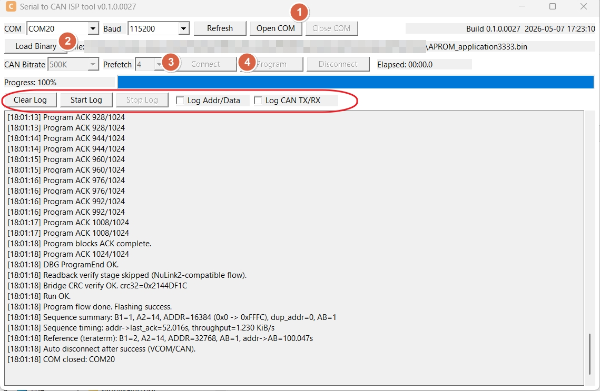

# simple_serial_to_CAN_tool

Windows MFC tool for updating a target MCU through a Nuvoton EVB bridge.

The PC tool talks to the EVB over Serial / USB VCOM / USB HID. The EVB then converts the update flow into 8-byte CAN ISP frames for the target bootloader.



## Release size

Release x64 EXE: 683520 bytes (comparable baseline 2777088).
Features, static runtime, required files and Win32 settings are retained.
See SELF_CHECK.md and the sanitized [verification record](docs/verification/exe-slimming-20261025.json)
for actual scope, measurements and limitations.

## Compiler-Only Clean

`scripts/clean_mfc.bat` and the existing clean entry remove known compiler files
only. Complete path/link preflight rejects reparse points before deletion;
EXE/INI/DLL/data/log/evidence/unknowns are preserved even under obj/tests/verify.
No additional manual setup is required.

## Overview

This project contains:
- a native Windows MFC GUI tool (`SerialToCanIspToolMfc.exe`)
- EVB firmware projects for multiple Nuvoton MCU BSPs
- the shared bridge application layer used across EVB platforms

The intended update path is:
- `PC Tool -> EVB (UART / USB VCOM / USB HID)`
- `EVB -> Target MCU (CAN ISP)`

## Requirements

- Windows 10/11 x64
- Visual Studio 2022 with MFC support
- Keil MDK / ArmClang for EVB firmware build
- A supported Nuvoton EVB, flashed with the matching firmware project under [`firmware/`](./firmware)
- A target board running the corresponding CAN ISP bootloader flow

## Supported EVB Boards

Use the EVB that matches the firmware BSP folder:

- `NK-M0A23OC` -> [`firmware/M0A21BSP_serial_to_CAN/`](./firmware/M0A21BSP_serial_to_CAN)
- `NK_M2A23SG` -> [`firmware/M2A23BSP_serial_to_CAN/`](./firmware/M2A23BSP_serial_to_CAN)
- `NK-M253LE` -> [`firmware/M253BSP_serial_to_CAN/`](./firmware/M253BSP_serial_to_CAN)
- `NK-M463KG` -> [`firmware/M463BSP_serial_to_CAN/`](./firmware/M463BSP_serial_to_CAN)
- `NK-M467HJ` -> [`firmware/M467BSP_serial_to_CAN/`](./firmware/M467BSP_serial_to_CAN)
- `NK-NUC131U` -> [`firmware/NUC131BSP_serial_to_CAN/`](./firmware/NUC131BSP_serial_to_CAN)
- `NK-NUC240V` -> [`firmware/NUC240BSP_serial_to_CAN/`](./firmware/NUC240BSP_serial_to_CAN)

## PC Tool Features

- COM open / close
- Binary loading
- CAN bitrate setup
- Connect / Program / Disconnect flow
- Progress bar and elapsed time
- Runtime log window
- Log recording to file
- INI-based UI state persistence

## Firmware Scope

Each EVB firmware project provides:
- PC-to-EVB protocol handling
- EVB-to-target CAN ISP bridge flow
- board-specific UART / CAN pinmux and driver backend

The upper bridge flow is shared. Platform differences are isolated to the local board config and CAN backend files inside each BSP folder.

## Build

### PC Tool

Recommended:

```powershell
powershell -ExecutionPolicy Bypass -File scripts\build_mfc.ps1 -Configuration Release -Platform x64
```

Alternative:

```bat
scripts\build_release_mfc.bat
```

Output:
- `build\SerialToCanIspToolMfc.exe`

### EVB Firmware

Each BSP folder contains its own Keil project under:

- `firmware/<BSP>/SampleCode/Template/Keil/`

Build the project that matches your EVB board.

## Quick Start

1. Build the PC tool.
2. Build and flash the matching EVB firmware.
3. Connect the PC tool to the EVB over USB VCOM.
4. Connect the EVB CAN bus to the target board.
5. Load the target application binary.
6. Open the transport and run:
   - `Connect`
   - `Program`
7. Confirm the target enters application code after update.

## Repository Layout

- [`src/`](./src) : MFC application source, resource script, and `res` icon assets
- [`scripts/`](./scripts) : build and utility scripts
- [`docs/`](./docs) : protocol and design notes
- [`docs/images/`](./docs/images) : documentation screenshots
- [`firmware/`](./firmware) : EVB firmware projects
- [`AGENTS.md`](./AGENTS.md) : project rules and engineering baseline
- [`HANDOFF.md`](./HANDOFF.md) : implementation handoff notes
- [`SELF_CHECK.md`](./SELF_CHECK.md) : regression / review checklist

## Notes

- This repository is intended to work with Nuvoton EVB hardware plus the matching firmware project under [`firmware/`](./firmware).
- The PC tool is an MFC native executable and does not require a Python runtime on the target Windows machine.
- Protocol details are documented in [`docs/PROTOCOL.md`](./docs/PROTOCOL.md).
